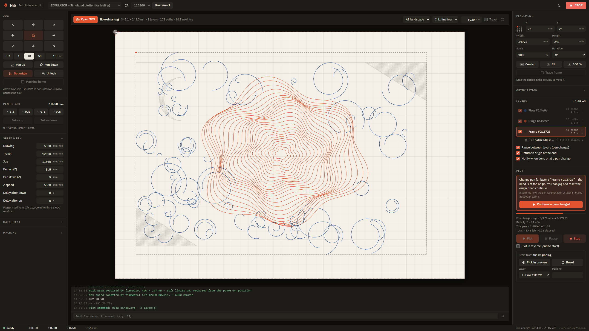

# Nib

*Pen plotter control – Every line, by the pen.*

Custom control software for the UUNATeK 3.0 pen plotter (GRBL/FluidNC over USB/CH340).
Runs on Windows and macOS. Light and dark theme (follows the system, or switch with the button at the top right).

**Every control and setting explained: [USAGE.md](USAGE.md)** · What's new: [CHANGELOG.md](CHANGELOG.md)

Light mode

*Screenshots at 2560 × 1440 (WQHD), using the built-in plotter simulator.*

## Getting started
Download the ready-to-run app from the **[latest release](https://github.com/pedda90/Nib/releases/latest)** –
no Python or installation needed.

**Windows 10/11:** download `Nib-…-windows.zip`, unpack it and put `Nib.exe` in a folder of its own.
Double-click it. Windows may warn about an unknown app because the exe isn't signed:
**More info → Run anyway**. Settings are saved next to the exe.

**macOS 11 or later, Apple Silicon (M1 or newer):** download `Nib-…-macos.zip`, unpack it and move
**Nib.app** to *Applications*. The first time, macOS says it can't verify the developer because the
app isn't signed: open **System Settings → Privacy & Security** and click **Open Anyway**
(on older macOS: right-click the app → **Open**). Settings live in `~/Library/Application Support/Nib`.

**Updating:** replace `Nib.exe` or `Nib.app` with the new version – settings are kept.

**Plotter connection:** USB. The plotter uses a CH340 chip: on Windows, install the CH340 driver if
no COM port shows up; macOS supports it out of the box (the port looks like `/dev/cu.usbserial-…`).

Then follow [First test with the real plotter](#first-test-with-the-real-plotter) below.
No plotter at hand? Choose the port **SIMULATOR** to try everything out.

### Running from source
For changing the code, or on an Intel Mac. Requires [Python 3](https://www.python.org/downloads/)
(tested with 3.13; on Windows tick “Add python.exe to PATH” during setup).

1. Download the code: **Code → Download ZIP** on GitHub (and unpack it), or `git clone`.
2. Start it – the first start sets up a Python environment and installs what Nib needs (a few minutes):
   - **Windows:** `Start Nib.bat` (opens Nib in the browser), or `build_exe.bat` to build `Nib.exe`.
   - **macOS:** `Start Nib.command` (opens Nib in its own window), or `build_app.command` to build
     `Nib.app`. If macOS refuses to open the script, run it in Terminal from the Nib folder:
     `bash "Start Nib.command"`.

**Version number:** `VERSION` in `server.py`; both build scripts take it from there.

**Compatibility:** Nib is made for and tested with the UUNATeK 3.0 (FluidNC firmware, pen on the
Z axis). Other GRBL/FluidNC plotters that lift the pen with a Z axis may work but are untested.

## Running Nib
Double-click **`Nib.exe`** (Windows) or **Nib.app** (macOS). Nib opens in its own window – no browser needed.
**Quitting:** close the window. If a plot is running (also paused or waiting for a pen change),
Nib asks first. Answering “Yes” aborts the plot and remembers the position so you can resume later.
Settings (`settings.json`) and the resume point (`job_state.json`) are stored next to the exe
(macOS: in `~/Library/Application Support/Nib`).

**Rebuilding the app** (after changing the code): double-click **`build_exe.bat`** (Windows) or
**`build_app.command`** (macOS). It takes about a minute and puts a new `Nib.exe` / `Nib.app` into
this folder. On Windows the window needs the Edge WebView2 runtime, which Windows 11 includes
(on Windows 10 it is installed with Microsoft Edge).

**In a browser instead:** `Start Nib.bat` serves the interface at http://127.0.0.1:8765.
Nib exits by itself when the browser window is closed, except while plotting.
For development, `server.py --keep-running` turns that off.

**Important:** close the UUNA software first. Only one program can use the plotter's port at a time.

## First test with the real plotter
1. Select the plotter's port at the top (e.g. **COM3**; Windows Device Manager shows it under
   “Ports”), then **Connect**. The console should show “Controller started: Grbl …”.
2. Try **Pen up** and **Pen down**. If needed, adjust “Pen up (Z)” / “Pen down (Z)” under *Speed & pen*.
   The defaults come from the UUNA configuration (0.5 mm / 5 mm).
3. Jog with the arrows and check: → moves right, ↓ moves towards you (down the sheet).
   If not, tick **Invert X**, **Invert Y** or **Swap X/Y** under *Machine*.
4. Move the pen to the **top-left corner of the sheet**, then press **Set origin**.
5. Load an SVG (**Open SVG**), then **Trace frame**: the raised pen traces the outline shown in the preview.
6. **Plot**.

## Features
- SVG from Illustrator, DrawingBotV3 etc. at the correct size in mm,
  keeping the position on the artboard.
- Layers by color or by Illustrator layer – toggle them, reorder them, automatic pause for pen changes.
- Path optimization: sort order, join connecting lines, remove duplicates, simplify (defaults are shown).
- Show or hide individual Illustrator layers within one pen color.
- Preview with travel moves and live progress (colours can be hidden in the preview even while plotting).
- Realistic time estimate (acceleration of the plotter included), remaining time for the current pen and in total.
- Pause/resume (also with the space bar), stop without losing the origin,
  **resume after an abort** (even after restarting the program) or start from any path.
- **Plot in reverse** (end to start) and pick the start point by clicking in the preview.
- Work-area limits measured from the power-on corner; speeds capped at the firmware maximum.
- Manual jogging, adjustable speeds, console for G-code and `$` commands.
- “SIMULATOR” port for trying things out without a plotter.
- Copes with a FluidNC quirk where acknowledgements (“ok”) occasionally go missing: the plot keeps
  running instead of stalling.

## Feedback and contributing
Found a bug or have an idea? Please open an [issue](https://github.com/pedda90/Nib/issues).
Changes are welcome as pull requests from a fork – see [CONTRIBUTING.md](CONTRIBUTING.md).

## License
Nib is a hobby project, and you're welcome to use it for free: for your own plots, for learning,
for tinkering with the code and for sharing it with others. Selling the drawings you make with it
is fine too.

The one thing I'd ask: please don't sell Nib itself or ship it with a product (like a plotter)
without talking to me first. If you have something like that in mind, just get in touch.

The fine print is in [LICENSE.md](LICENSE.md) (PolyForm Noncommercial 1.0.0).

© 2026 Peter Dietrich

## Files
| File | Contents |
|---|---|
| `server.py` | Web server and job control |
| `grbl.py` | Connection, streaming, plot job |
| `svgload.py` | SVG import |
| `optimize.py` | Path optimization |
| `gcode.py` | Placement and G-code |
| `mockgrbl.py` | Simulated plotter |
| `app.py` | Program window (Nib.exe / Nib.app) |
| `build_exe.bat`, `Start Nib.bat` | Build / start on Windows (`version_info.py` adds the version to the exe) |
| `build_app.command`, `Start Nib.command` | Build / start on macOS |
| `web/` | User interface (fonts: IBM Plex, SIL Open Font License, see `web/fonts/`) |
| `settings.json`, `job_state.json` | Saved settings and resume point (created automatically) |
