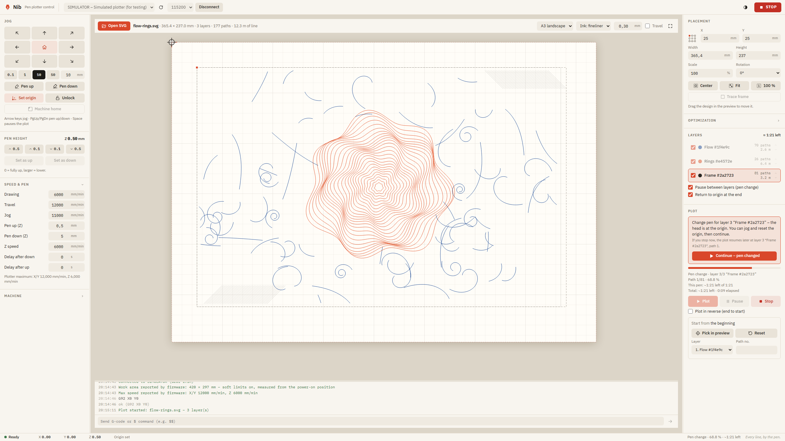

# Nib

*Pen plotter control – Every line, by the pen.*

Custom control software for the UUNATeK 3.0 pen plotter (GRBL/FluidNC over USB/CH340).
Light and dark theme (follows Windows, or switch with the button at the top right).

**Every control and setting explained: [USAGE.md](USAGE.md)**

Dark mode

*Screenshots at 2560 × 1440 (WQHD), using the built-in plotter simulator.*

## Getting started
**Requirements:** Windows 10 or 11 and [Python 3](https://www.python.org/downloads/) (tested with 3.13;
tick “Add python.exe to PATH” during setup). The plotter connects over USB; it uses a CH340 chip,
so if no COM port shows up, install the CH340 driver.

1. Download the code: **Code → Download ZIP** on GitHub (and unpack it), or `git clone`.
2. Double-click **`build_exe.bat`**. The first time it sets up a Python environment and installs
   what Nib needs (a few minutes), then builds **`Nib.exe`** in the same folder.
3. Start **`Nib.exe`**. Windows may warn about an unknown app because the exe isn't signed:
   **More info → Run anyway**.

Then follow [First test with the real plotter](#first-test-with-the-real-plotter) below.
No plotter at hand? Choose the port **SIMULATOR** to try everything out.

**Compatibility:** Nib is made for and tested with the UUNATeK 3.0 (FluidNC firmware, pen on the
Z axis). Other GRBL/FluidNC plotters that lift the pen with a Z axis may work but are untested.

## Running Nib
Double-click **`Nib.exe`**. Nib opens in its own window – no browser needed.
**Quitting:** close the window. If a plot is running (also paused or waiting for a pen change),
Nib asks first. Answering “Yes” aborts the plot and remembers the position so you can resume later.
Settings (`settings.json`) and the resume point (`job_state.json`) are stored next to the exe.

**Rebuilding the exe** (after changing the code): double-click **`build_exe.bat`**. It takes about
half a minute and puts a new `Nib.exe` into this folder. Requires Python and Windows 11
(or the Edge WebView2 runtime, which Windows 11 includes).

**In a browser instead:** `Start Nib.bat` serves the interface at http://127.0.0.1:8765.
Nib exits by itself when the browser window is closed, except while plotting.
For development, `server.py --keep-running` turns that off.

**Important:** close the UUNA software first. Only one program can use the plotter's COM port at a time.

## First test with the real plotter
1. Select the plotter's port at the top (e.g. **COM3**; Windows Device Manager shows it under
   “Ports”), then **Connect**. The console should show “Controller started: Grbl …”.
2. Try **Pen up** and **Pen down**. If needed, adjust “Pen up (Z)” / “Pen down (Z)” under *Speed & pen*.
   The defaults come from the UUNA configuration (0.5 mm / 5 mm).
3. Jog with the arrows and check: → moves right, ↓ moves towards you (down the sheet).
   If not, tick **Invert X**, **Invert Y** or **Swap X/Y** under *Machine*.
4. Move the pen to the **top-left corner of the sheet**, then press **Set origin**.
5. Load an SVG (**Open SVG**), then **Trace frame**: the raised pen traces the outline shown in the preview.
6. **Plot**.

## Features
- SVG from Illustrator, DrawingBotV3 etc. at the correct size in mm,
  keeping the position on the artboard.
- Layers by color or by Illustrator layer – toggle them, reorder them, automatic pause for pen changes.
- Path optimization: sort order, join connecting lines, remove duplicates, simplify (defaults are shown).
- Show or hide individual Illustrator layers within one pen color.
- Preview with travel moves and live progress (colours can be hidden in the preview even while plotting).
- Realistic time estimate (acceleration of the plotter included), remaining time for the current pen and in total.
- Pause/resume (also with the space bar), stop without losing the origin,
  **resume after an abort** (even after restarting the program) or start from any path.
- **Plot in reverse** (end to start) and pick the start point by clicking in the preview.
- Work-area limits measured from the power-on corner; speeds capped at the firmware maximum.
- Manual jogging, adjustable speeds, console for G-code and `$` commands.
- “SIMULATOR” port for trying things out without a plotter.
- Copes with a FluidNC quirk where acknowledgements (“ok”) occasionally go missing: the plot keeps
  running instead of stalling.

## Feedback and contributing
Found a bug or have an idea? Please open an [issue](https://github.com/pedda90/Nib/issues).
Changes are welcome as pull requests from a fork – see [CONTRIBUTING.md](CONTRIBUTING.md).

## License
Nib is free for noncommercial use under the
[PolyForm Noncommercial License 1.0.0](LICENSE.md): personal use, hobby projects, studying and
changing the code, sharing it for free. **You may also sell plots and artwork you make with Nib.**
Selling or bundling Nib itself, for example with a plotter or another product, is not permitted
without written permission – just ask if you are interested.

© 2026 Peter Dietrich

## Files
| File | Contents |
|---|---|
| `server.py` | Web server and job control |
| `grbl.py` | Connection, streaming, plot job |
| `svgload.py` | SVG import |
| `optimize.py` | Path optimization |
| `gcode.py` | Placement and G-code |
| `mockgrbl.py` | Simulated plotter |
| `app.py` | Program window (Nib.exe) |
| `web/` | User interface (fonts: IBM Plex, SIL Open Font License, see `web/fonts/`) |
| `settings.json`, `job_state.json` | Saved settings and resume point (created automatically) |
